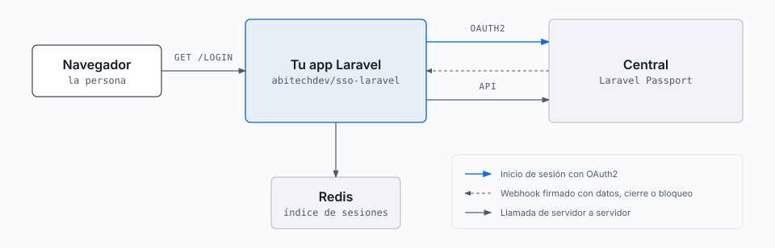

<p align="center">
  <picture>
    <source media="(prefers-color-scheme: dark)" srcset="docs/imagenes/logo-oscuro.svg">
    
  </picture>
</p>

<h1 align="center">SSO Laravel</h1>

<p align="center">Connects Laravel apps to a Laravel Passport identity hub for single sign-on and user sync</p>

<p align="center">
  <a href="https://packagist.org/packages/abitechdev/sso-laravel"></a>
  <a href="https://github.com/abitech-dev/abitech-sso-laravel/actions/workflows/ci.yml"></a>
  
  <a href="LICENSE"></a>
</p>

<p align="center">
  <a href="#quick-start">Quick start</a> &nbsp;|&nbsp;
  <a href="#usage">Usage</a> &nbsp;|&nbsp;
  <a href="#documentation">Documentation</a> &nbsp;|&nbsp;
  <a href="README.md">Español</a>
</p>

<picture>
  <source media="(prefers-color-scheme: dark)" srcset="docs/diagramas/flujo-dark.svg">
  
</picture>

A company with several Laravel apps and a Laravel Passport identity hub
installs the package in each app, and people sign in once to use them all.
Arsy uses it to connect its apps to its hub, account.

## What it does

<table>
  <tr>
    <td width="50%" valign="top">
      <picture><source media="(prefers-color-scheme: dark)" srcset="docs/iconos/acceso-dark.svg"></picture><br><strong>Sign-in, ready</strong><br>Login, callback and logout routes with OAuth2 against the hub.
    </td>
    <td width="50%" valign="top">
      <picture><source media="(prefers-color-scheme: dark)" srcset="docs/iconos/silencioso-dark.svg"></picture><br><strong>No second prompt</strong><br>If the person already signed in at the hub, the app knows them, Inertia included.
    </td>
  </tr>
  <tr>
    <td width="50%" valign="top">
      <picture><source media="(prefers-color-scheme: dark)" srcset="docs/iconos/webhook-dark.svg"></picture><br><strong>Changes right away</strong><br>Signed webhooks update, sign out or block the user.
    </td>
    <td width="50%" valign="top">
      <picture><source media="(prefers-color-scheme: dark)" srcset="docs/iconos/datos-dark.svg"></picture><br><strong>Your database, untouched</strong><br>It only adds <code>sso_id</code> and <code>sso_last_login_at</code> to <code>users</code>.
    </td>
  </tr>
  <tr>
    <td width="50%" valign="top">
      <picture><source media="(prefers-color-scheme: dark)" srcset="docs/iconos/servidor-dark.svg"></picture><br><strong>Server-to-server calls</strong><br><code>Http::ssoCentral()</code> calls the hub with a cached token.
    </td>
    <td width="50%" valign="top">
      <picture><source media="(prefers-color-scheme: dark)" srcset="docs/iconos/eventos-dark.svg"></picture><br><strong>Your data, your way</strong><br>Events to store name, avatar or roles in each app.
    </td>
  </tr>
</table>

## Quick start

```bash
composer require abitechdev/sso-laravel
php artisan vendor:publish --tag=sso-config
php artisan migrate
```

```env
SSO_OAUTH_URL=https://central.example.com
SSO_CLIENT_ID=...
SSO_CLIENT_SECRET=...
SSO_WEBHOOK_SECRET=...
```

With those four variables, `GET /login` sends the person to the hub and
brings them back signed in. Registering the app at the hub and the other
variables are covered in the [usage guide](docs/guia-de-uso.md), in Spanish.

## Usage

Listen to sign-ins to store your app's own data:

```php
use Abitech\Sso\Events\SsoUserAuthenticated;
use Illuminate\Support\Facades\Event;

Event::listen(function (SsoUserAuthenticated $event) {
    $event->user->update(['avatar' => $event->idpUser->getAvatar()]);
});
```

And call the hub as the app itself:

```php
$response = Http::ssoCentral(['billing:checkout'])->post('/api/v1/checkout');
```

## Compatibility

| Tool | Version |
| --- | --- |
| PHP | 8.2 or later; 8.3 with Laravel 13 |
| Laravel | 12 or 13 |
| Redis | For single sign-out, with `SESSION_DRIVER=redis` |

## Documentation

| I want to… | Document |
| --- | --- |
| Install the package in an app | [guia-de-uso.md](docs/guia-de-uso.md) (Spanish) |
| Understand how it is built | [construccion.md](docs/construccion.md) (Spanish) |
| Know why it is released this way | [ADR 0001](docs/decisiones/0001-ramas-y-publicacion.md) (Spanish) |
| See changes by version | [CHANGELOG.md](CHANGELOG.md) |

## Contributing

The steps and what continuous integration checks are in
[CONTRIBUTING.md](CONTRIBUTING.md). To report a vulnerability, follow
[SECURITY.md](SECURITY.md).

## License

Copyright © 2026 ABItech Perú. MIT license, see [LICENSE](LICENSE).
