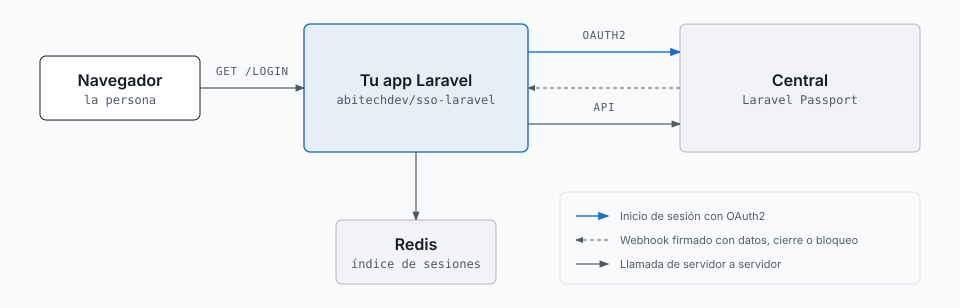

<p align="center">
  <picture>
    <source media="(prefers-color-scheme: dark)" srcset="docs/imagenes/logo-oscuro.svg">
    
  </picture>
</p>

<h1 align="center">SSO Laravel</h1>

<p align="center">Conecta apps Laravel con una central en Laravel Passport para el inicio de sesión único y la sincronización de usuarios</p>

<p align="center">
  <a href="https://packagist.org/packages/abitechdev/sso-laravel"></a>
  <a href="https://github.com/abitech-dev/abitech-sso-laravel/actions/workflows/ci.yml"></a>
  
  <a href="LICENSE"></a>
</p>

<p align="center">
  <a href="#inicio-rápido">Inicio rápido</a> &nbsp;|&nbsp;
  <a href="#uso">Uso</a> &nbsp;|&nbsp;
  <a href="#documentación">Documentación</a> &nbsp;|&nbsp;
  <a href="README.en.md">English</a>
</p>

<picture>
  <source media="(prefers-color-scheme: dark)" srcset="docs/diagramas/flujo-dark.svg">
  
</picture>

Una empresa con varias apps Laravel y una central de identidad en Laravel
Passport instala el paquete en cada app, y la persona entra una sola vez para
usarlas todas. Arsy lo usa para conectar sus apps con su central, account.

## Qué resuelve

<table>
  <tr>
    <td width="50%" valign="top">
      <picture><source media="(prefers-color-scheme: dark)" srcset="docs/iconos/acceso-dark.svg"></picture><br><strong>Inicio de sesión listo</strong><br>Rutas de entrada, callback y salida con OAuth2 contra la central.
    </td>
    <td width="50%" valign="top">
      <picture><source media="(prefers-color-scheme: dark)" srcset="docs/iconos/silencioso-dark.svg"></picture><br><strong>Sin volver a pedir datos</strong><br>Si la persona ya entró en la central, la app la reconoce, también con Inertia.
    </td>
  </tr>
  <tr>
    <td width="50%" valign="top">
      <picture><source media="(prefers-color-scheme: dark)" srcset="docs/iconos/webhook-dark.svg"></picture><br><strong>Cambios al instante</strong><br>Webhooks firmados actualizan, cierran la sesión o bloquean al usuario.
    </td>
    <td width="50%" valign="top">
      <picture><source media="(prefers-color-scheme: dark)" srcset="docs/iconos/datos-dark.svg"></picture><br><strong>Tu base, intacta</strong><br>Solo suma <code>sso_id</code> y <code>sso_last_login_at</code> a <code>users</code>.
    </td>
  </tr>
  <tr>
    <td width="50%" valign="top">
      <picture><source media="(prefers-color-scheme: dark)" srcset="docs/iconos/servidor-dark.svg"></picture><br><strong>Llamadas entre servidores</strong><br><code>Http::ssoCentral()</code> llama a la central con su token en caché.
    </td>
    <td width="50%" valign="top">
      <picture><source media="(prefers-color-scheme: dark)" srcset="docs/iconos/eventos-dark.svg"></picture><br><strong>Tus datos, a tu manera</strong><br>Eventos para guardar nombre, avatar o roles en cada app.
    </td>
  </tr>
</table>

## Inicio rápido

```bash
composer require abitechdev/sso-laravel
php artisan vendor:publish --tag=sso-config
php artisan migrate
```

```env
SSO_OAUTH_URL=https://central.example.com
SSO_CLIENT_ID=...
SSO_CLIENT_SECRET=...
SSO_WEBHOOK_SECRET=...
```

Con esas cuatro variables, `GET /login` ya lleva a la persona a la central y
la devuelve con su sesión iniciada. El registro de la app en la central y el
resto de variables están en la [guía de uso](docs/guia-de-uso.md).

## Uso

Escucha el inicio de sesión para guardar los datos propios de tu app:

```php
use Abitech\Sso\Events\SsoUserAuthenticated;
use Illuminate\Support\Facades\Event;

Event::listen(function (SsoUserAuthenticated $evento) {
    $evento->user->update(['avatar' => $evento->idpUser->getAvatar()]);
});
```

Y llama a la central como la propia app:

```php
$respuesta = Http::ssoCentral(['billing:checkout'])->post('/api/v1/checkout');
```

## Compatibilidad

| Herramienta | Versión |
| --- | --- |
| PHP | 8.2 o superior; 8.3 con Laravel 13 |
| Laravel | 12 o 13 |
| Redis | Para el cierre de sesión único, con `SESSION_DRIVER=redis` |

## Documentación

| Quiero… | Documento |
| --- | --- |
| Instalar el paquete en una app | [guia-de-uso.md](docs/guia-de-uso.md) |
| Entender cómo está construido | [construccion.md](docs/construccion.md) |
| Saber por qué se publica así | [ADR 0001](docs/decisiones/0001-ramas-y-publicacion.md) |
| Ver los cambios por versión | [CHANGELOG.md](CHANGELOG.md) |

## Contribuir

Los pasos y lo que revisa la integración continua están en
[CONTRIBUTING.md](CONTRIBUTING.md). Para reportar una vulnerabilidad, sigue
[SECURITY.md](SECURITY.md).

## Licencia

Copyright © 2026 ABItech Perú. Licencia MIT, cuyo texto figura en
[LICENSE](LICENSE).
