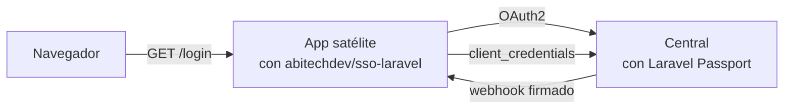

# SSO Laravel

Conecta apps Laravel con una central en Laravel Passport para el inicio de sesión único y la sincronización de usuarios

<p>
  <a href="https://packagist.org/packages/abitechdev/sso-laravel"></a>
  <a href="https://github.com/abitech-dev/abitech-sso-laravel/actions/workflows/ci.yml"></a>
  
  <a href="LICENSE"></a>
</p>



Sirve a cualquier empresa con una central de identidad en Laravel Passport y
varias apps satélite. Arsy lo usa para conectar sus apps con account.

## Características

- Rutas de inicio de sesión, callback y cierre de sesión listas, con OAuth2
  contra la central por Socialite y Laravel Passport.
- Inicio de sesión silencioso, que entra sin pedir datos si la persona ya
  inició sesión en la central, también desde páginas de Inertia.
- Webhooks firmados que actualizan al usuario, cierran sus sesiones o lo
  bloquean al suspenderlo o eliminarlo.
- Solo agrega `sso_id` y `sso_last_login_at` a `users` y deja `password`
  nullable, porque un usuario SSO no tiene contraseña local.
- `Http::ssoCentral($scopes)` para llamar a la central de servidor a
  servidor, con el token en caché.
- Eventos para guardar los datos propios de cada app, como nombre, avatar o
  roles.

## Requisitos

| Herramienta | Versión |
| --- | --- |
| PHP | 8.2 o superior; 8.3 con Laravel 13 |
| Laravel | 12 o 13 |
| Redis | para el cierre de sesión único, con `SESSION_DRIVER=redis` |

## Inicio rápido

```bash
composer require abitechdev/sso-laravel
php artisan vendor:publish --tag=sso-config
php artisan migrate
```

Las variables de entorno y el registro de la app en la central se explican
en la [guía de uso](docs/guia-de-uso.md).

## Uso

| Evento | Cuándo se dispara |
| --- | --- |
| `SsoUserAuthenticated` | Una persona inicia sesión |
| `SsoWebhookUserUpdated` | La persona cambia sus datos en la central |
| `SsoUserLoggedOutViaWebhook` | La central cierra su sesión |
| `SsoWebhookUserSuspended` | La central suspende al usuario |
| `SsoWebhookUserDeleted` | La central elimina al usuario |

Todos viven en `Abitech\Sso\Events`.

## Documentación

| Quiero… | Documento |
| --- | --- |
| Instalar el paquete en una app | [guia-de-uso.md](docs/guia-de-uso.md) |
| Entender cómo está construido | [construccion.md](docs/construccion.md) |
| Saber por qué se publica así | [ADR 0001](docs/decisiones/0001-ramas-y-publicacion.md) |
| Ver los cambios por versión | [CHANGELOG.md](CHANGELOG.md) |

## Contribuir

Los pasos y lo que revisa la integración continua están en
[CONTRIBUTING.md](CONTRIBUTING.md).

## Licencia

Copyright © 2026 ABItech Perú. Licencia MIT, cuyo texto figura en
[LICENSE](LICENSE).
